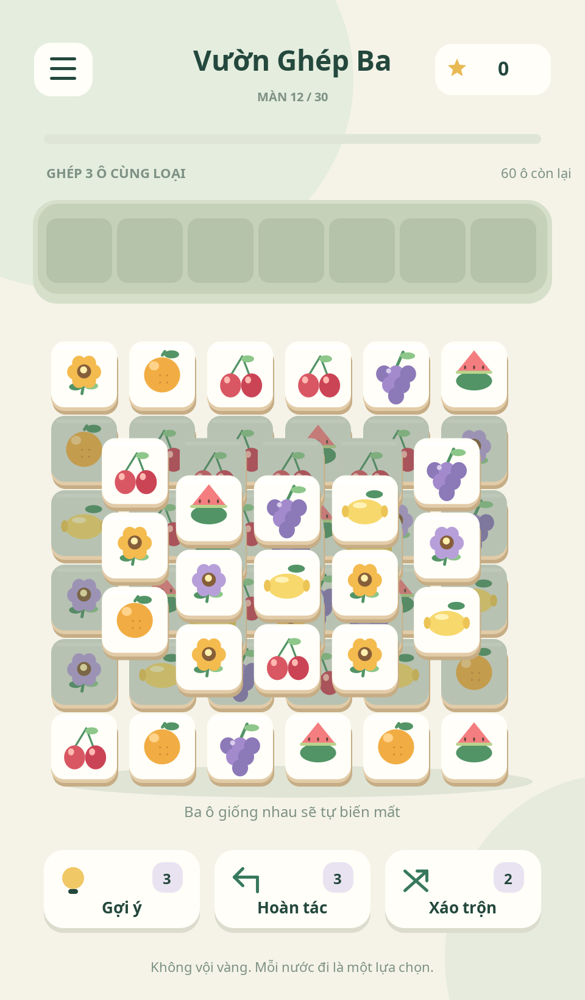

# Vườn Ghép Ba

**Game thứ hai:** [Đại Lộ Zombie](zombie-rush/README.md) — game chạy vô tận với cả đàn zombie, có bản EXE, APK và source NetBeans riêng trong thư mục `downloads`.

Game Java ghép ba ô cùng loại, giao diện tiếng Việt, dùng được với chuột trên máy tính và cảm ứng trên Android. Có 30 màn xếp lớp, khay 7 ô, điểm, sao, mở khóa màn, tạm dừng, âm thanh, tự lưu tiến độ; mỗi màn có 3 gợi ý, 3 hoàn tác và 2 xáo trộn. Chơi offline, không có quảng cáo hay mua hàng.

Đồ họa và tên game được tạo riêng, lấy cảm hứng từ thể loại tile triple match trong ảnh tham khảo.

## Tải game và source

* [Tải bộ cài Windows EXE — kèm Java](https://github.com/ngocduc1703-cloud/Moi/raw/refs/heads/main/downloads/VuonGhepBa-Setup.exe)
* [Tải APK Android](https://github.com/ngocduc1703-cloud/Moi/raw/refs/heads/main/downloads/VuonGhepBa-Android.apk)
* [Tải source Java cho NetBeans](https://github.com/ngocduc1703-cloud/Moi/raw/refs/heads/main/downloads/VuonGhepBa-NetBeans-Source.zip)

Các file nằm trong thư mục [downloads](downloads). Nếu repository riêng tư, đăng nhập tài khoản GitHub có quyền truy cập trước khi tải. Có thể tải cả repository qua **Code → Download ZIP**; các bộ cài sẽ ở thư mục `downloads` sau khi giải nén.

## Cài đặt để chơi

### Windows 10/11 64-bit

Chạy `VuonGhepBa-Setup.exe`, chọn thư mục và cài. Installer tạo shortcut và mục gỡ cài đặt cho tài khoản hiện tại, kèm Java runtime; không cần cài Java riêng hay quyền quản trị.

Cách dùng bản portable: giải nén **toàn bộ** `VuonGhepBa-Windows-Portable.zip`, giữ `VuonGhepBa.exe` cạnh thư mục `runtime`, rồi chạy EXE. EXE đơn lẻ không chứa runtime.

Bản phát triển này chưa ký chứng thư Authenticode, Windows có thể hiển thị nhà phát hành chưa xác định. APK được ký bằng khóa phát triển, chưa phải bản phát hành trên Google Play.

### Android 6.0 trở lên

Chép `VuonGhepBa-Android.apk` vào điện thoại và mở file. Nếu thiết bị yêu cầu, cấp quyền “Cài ứng dụng không rõ nguồn gốc” cho ứng dụng đang mở APK. Game không yêu cầu quyền Internet, tài khoản hay quyền truy cập tệp của bạn. iPhone/iOS không cài được APK.

Tiến độ Android nằm trong bộ nhớ riêng của ứng dụng. Windows lưu ở `%USERPROFILE%\.vuon-ghep-ba\save.properties`. Xóa dữ liệu ứng dụng sẽ xóa tiến độ. Hoàn tác chỉ áp dụng các nước đi trong phiên hiện tại; bàn chơi và số trợ giúp còn lại được lưu khi thoát.

## Mở source trong NetBeans

1. Cài JDK 21 và Apache NetBeans có hỗ trợ Java/Maven. Giải nén `VuonGhepBa-NetBeans-Source.zip`.
2. Trong NetBeans chọn **File → Open Project**, mở thư mục có `pom.xml`. Mở thêm hai project con `core` và `desktop` nếu chưa hiển thị.
3. Nhấp phải project gốc → **Clean and Build** để xây dựng và chạy kiểm thử. NetBeans sẽ tải các thư viện Maven lần đầu.
4. Nhấp phải project **Garden · Windows / Desktop** → **Run**. Có sẵn `desktop/nbactions.xml` với lớp `vn.garden.desktop.DesktopLauncher`. Để chạy riêng module sau lần tải source mới, xây dựng/cài core trước bằng `mvn install` tại gốc.
5. Sửa luật chơi tại `core/src/main/java/vn/garden/core/Game.java`; sửa giao diện chung ở `Scene.java`, đồ họa ở `Art.java`. Android dùng cùng những tệp này, không phải sao chép logic sang ngôn ngữ khác.

NetBeans dùng Maven cho project này. Android APK được đóng gói bằng SDK chính thức thông qua builder Java đi kèm; không yêu cầu plugin Android cũ của NetBeans. NetBeans có thể sửa source Android, build APK qua custom goal; cài APK lên máy hoặc giả lập dùng `adb` từ Android SDK Platform Tools.

## Build thủ công

JDK 21, Maven 3.9+, Android SDK Platform 35 và Build Tools 35.0.0. Biến `JAVA_HOME` chỉ tới JDK, `ANDROID_HOME` chỉ tới SDK. Các lệnh chạy ở thư mục gốc chứa `pom.xml`.

```sh
mvn clean install
java -jar desktop/target/desktop-1.0.0.jar
mvn clean package -Pandroid
mvn clean package -Pwindows
```

* JAR ở `desktop/target/desktop-1.0.0.jar`, chạy trên máy có Java.
* APK ở `dist/VuonGhepBa-Android.apk`.
* Launcher EXE ở `dist/windows/VuonGhepBa.exe`. Để phân phối, thêm Temurin JRE Windows x64 21 vào `dist/windows/runtime`.
* `mvn clean package -Pandroid,windows` xây dựng cả hai và chạy kiểm thử.

Trên NetBeans, project gốc có custom goals **Build Android APK** và **Build Windows EXE** trong **Run Maven**. Với Android, đặt `ANDROID_HOME` trước khi mở NetBeans; nếu cần truyền trực tiếp, thêm `-Dandroid.home=C:/Android/Sdk` trong cấu hình goal. Cần có platform 35 và build-tools 35.0.0 trong SDK.

Đóng APK riêng, không chạy Maven:

```powershell
./scripts/build-android.ps1
# Hoặc trực tiếp bằng JDK:
java scripts/AndroidBuild.java . $env:ANDROID_HOME
```

Linux/macOS: `bash scripts/build-android.sh`. Builder chạy `javac`, `d8`, `aapt2`, `zipalign`, `apksigner`; không cần Gradle. Có thể cài SDK qua Android Studio → SDK Manager hoặc `sdkmanager "platforms;android-35" "build-tools;35.0.0"` sau khi đọc/chấp nhận điều khoản SDK.

Tạo installer Windows sau khi có launcher và runtime: cài NSIS 3.11, chạy `makensis scripts/windows-installer.nsi`. Portable phải giữ toàn bộ runtime và giấy phép kèm theo. Trong cloud Linux, dùng `bash scripts/build-windows.sh` để tải runtime có kiểm tra SHA-256, build launcher và tạo ZIP; nếu có makensis, script cũng tạo installer.

## Khóa ký Android

Lần build đầu tạo khóa phát triển tại `.build/keys/garden-dev.p12` với alias `garden-dev`, mật khẩu mẫu `android`. Khóa này không nằm trong source ZIP. Các lần build sau giữ nguyên khóa để cập nhật APK mà không cần gỡ bản cũ. Khi giải nén source sang máy khác, khóa phát triển mới sẽ khác: không cập nhật được bản APK hiện có nếu không dùng lại khóa hoặc gỡ bản cũ (gỡ sẽ xóa tiến độ).

Để phát hành, tự tạo và lưu an toàn khóa riêng, đặt `GARDEN_KEYSTORE` (đường dẫn), `GARDEN_KEY_ALIAS`, `GARDEN_STORE_PASS` rồi build. Không đưa khóa riêng/mật khẩu lên GitHub. APK hiện tại dành cho cài thử; chưa có chứng thư phát hành hoặc trang Google Play.

## Phát triển trong cloud

Mỗi task có môi trường cô lập. Dùng checkout `/workspace/Moi` hiện có, không cần tạo worktree.

```sh
bash scripts/bootstrap.sh
source scripts/cloud-java-env.sh
mvn "${MAVEN_SETTINGS[@]}" -Dmaven.repo.local="$CACHE_DIR/m2" clean package -Pandroid,windows
mkdir -p /workspace/.tile-state
java -Duser.home=/workspace/.tile-state -jar desktop/target/desktop-1.0.0.jar
```

`bootstrap.sh` dành cho cloud Linux x64, tải JDK/Maven/SDK với checksum. `cloud-java-env.sh` dùng proxy và chứng chỉ đã cấp trên máy, không tắt xác minh TLS. Nếu máy không có màn hình, có thể xuất ảnh bằng `--screenshot output.png` hoặc `--screenshot output.png game`; kiểm tra cửa sổ và chuột bằng `--smoke-test` dưới Xvfb.

## Kiểm thử và giới hạn xác thực

`mvn test` chạy kiểm thử luật chơi: giải toàn bộ 30 màn với nhiều seed, ô bị che, ghép ba, hoàn tác, thua khi khay đầy, xáo trộn, lưu/đọc, trợ giúp và mở khóa màn.

Xem [docs/VALIDATION.md](docs/VALIDATION.md) để biết kiểm tra thực tế của bản giao. APK và EXE đã được dựng; kiểm tra chức năng Java dùng chung và cửa sổ desktop được thực hiện trong Linux. Cài và chạy trên Windows/điện thoại thật cần được thử tiếp trên các thiết bị đó.



Giấy phép source: [MIT](LICENSE). Thành phần bên thứ ba: [docs/THIRD_PARTY.md](docs/THIRD_PARTY.md).
