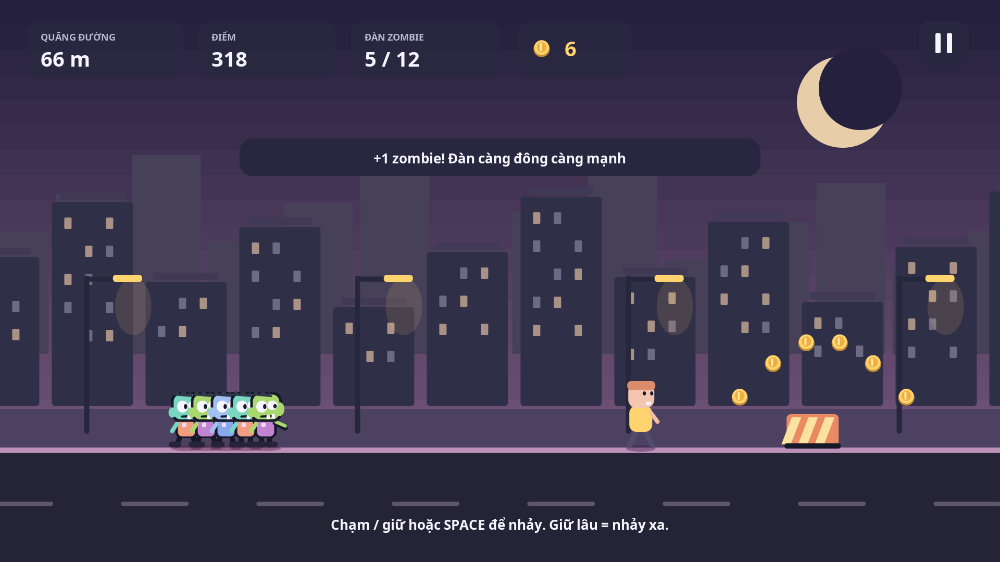

# Đại Lộ Zombie

Game Java chạy vô tận lấy cảm hứng từ cách điều khiển đàn zombie của Zombie Tsunami. Tên, giao diện, nhân vật và hình vẽ được tạo riêng. Chơi offline trên máy tính hoặc Android, không quảng cáo, không tài khoản và không mua hàng bằng tiền thật.

## Tải bản chơi và source

* [Bộ cài Windows EXE, kèm Java](https://github.com/ngocduc1703-cloud/Moi/raw/refs/heads/main/downloads/DaiLoZombie-Setup.exe)
* [APK Android](https://github.com/ngocduc1703-cloud/Moi/raw/refs/heads/main/downloads/DaiLoZombie-Android.apk)
* [Source Java cho NetBeans](https://github.com/ngocduc1703-cloud/Moi/raw/refs/heads/main/downloads/DaiLoZombie-NetBeans-Source.zip)

Windows: chạy installer, cài cho tài khoản hiện tại rồi mở shortcut **Dai Lo Zombie**. Có sẵn runtime Java, không cần cài Java riêng. Cần Windows 10/11 64-bit. Bản portable nếu tự build cần giữ EXE và thư mục `runtime` cùng nhau.

Android: mở APK trên điện thoại, cấp quyền cài từ nguồn đó nếu Android yêu cầu. Cần Android 6.0 trở lên, màn hình ngang. APK không cài trên iPhone/iOS. Không cần quyền Internet hay truy cập tệp của người dùng.

## Cách chơi

* Đàn tự chạy. **Chạm/giữ**, **nhấn/giữ chuột trái**, hoặc **SPACE** để nhảy; thả sớm sẽ nhảy thấp, giữ lâu sẽ nhảy cao và xa hơn.
* Các zombie phía sau thực hiện cú nhảy tại cùng vị trí với zombie đi đầu. Chạy ngang người đi đường để rủ thêm thành viên, tối đa 12 zombie.
* Nhảy qua rào chắn và hố. Từ **4 zombie** trở lên, đàn có thể lật xe; đàn nhỏ cần nhảy qua xe. Va chạm hoặc rơi xuống hố sẽ mất thành viên. Hết cả đàn thì ván kết thúc.
* **Khiên:** bảo vệ khỏi xe/rào 8 giây, vẫn cần nhảy qua hố. **Nam châm:** hút xu gần đó 10 giây, có thể nâng cấp thời lượng. **Khổng lồ:** vượt xe, rào và hố trong 8 giây.
* Menu tạm dừng ở góc phải; máy tính có thể dùng **P/Esc**. Mất focus cửa sổ hoặc chuyển ứng dụng Android sẽ tạm dừng để không tự mất đàn.
* Xu, kỷ lục và nâng cấp lưu khi tạm dừng, kết thúc hoặc đóng game. Ván đang chạy không được khôi phục sau khi tắt hoàn toàn; lần mở sau bắt đầu ván mới.

Độ khó tăng dần theo quãng đường; các đoạn đường, rào, xe, hố, xu và người được sinh liên tục. Nền thành phố cuộn nhiều lớp và đổi bảng màu theo quãng đường.

## Nâng cấp bằng xu trong game

| Nâng cấp | Mặc định | Tối đa |
| --- | --- | --- |
| Đàn khởi đầu | 3 zombie | 6 zombie |
| Nam châm | 10 giây/lần nhặt | 19 giây/lần nhặt |
| Giá trị xu | 1 xu mỗi đồng | 3 xu mỗi đồng |

Nâng cấp không thể mua nếu thiếu xu hoặc đã đạt giới hạn; không thể làm ví xu âm. Điểm tính theo quãng đường, xu, số người được rủ và số xe đã lật.

## Mở trong NetBeans

1. Giải nén `DaiLoZombie-NetBeans-Source.zip`; cài JDK 21 và NetBeans có Java/Maven.
2. **File → Open Project** → chọn thư mục `DaiLoZombie` có `pom.xml`. Nếu dùng source repository, chọn thư mục `zombie-rush`, đây là project độc lập với Vườn Ghép Ba.
3. Build/Install project gốc, mở project con `desktop` và **Run**. Có sẵn cấu hình `nbactions.xml`; nếu chạy bằng dòng lệnh, dùng lệnh bên dưới.
4. Luật chơi: `core/.../RunGame.java`; đồ họa: `Art.java`; giao diện: `Scene.java`; tiến độ/nâng cấp: `Profile.java`. Desktop và Android dùng chung toàn bộ các tệp này.

```sh
mvn clean install
java -jar desktop/target/desktop-1.0.0.jar
```

Android source ở module `android`. NetBeans sửa source và build APK qua custom goal dùng Maven/Android SDK; không yêu cầu plugin Android cũ. Cài/chạy APK trên thiết bị bằng Android hoặc `adb` của Platform Tools.

## Build APK và EXE

JDK 21, Maven 3.9+, Android SDK Platform 35 và Build Tools 35.0.0. Đặt `JAVA_HOME`, `ANDROID_HOME`; chạy từ thư mục project `zombie-rush` (hoặc `DaiLoZombie` sau giải nén).

```sh
mvn clean package -Pandroid,windows
```

APK: `dist/DaiLoZombie-Android.apk`; launcher: `dist/windows/DaiLoZombie.exe`. Launcher cần Temurin JRE Windows x64 21 trong `dist/windows/runtime`. Các custom goals **Build Android APK** và **Build Windows EXE** có sẵn trong NetBeans.

Đóng APK không dùng Maven: `java scripts/AndroidBuild.java . <ANDROID_SDK>` hoặc `scripts/build-android.ps1` trên Windows, `bash scripts/build-android.sh` trên Linux/macOS. Builder dùng javac/d8/aapt2/zipalign/apksigner của SDK chính thức.

Tạo installer sau khi có launcher/runtime: dùng NSIS 3.11 chạy `makensis scripts/windows-installer.nsi`. Trong cloud Linux có thể chạy `bash scripts/build-windows.sh` để kiểm tra/tải JRE, build EXE và tạo installer/portable ZIP. Giữ giấy phép JRE và launcher kèm bản phân phối.

## Khóa ký và dữ liệu lưu

APK được ký bằng khóa phát triển tự tạo ở `.build/keys/zombie-dev.p12`, alias `zombie-dev`, mật khẩu mẫu `android`. Không đưa khóa lên Git hoặc vào ZIP source. Giữ khóa nếu muốn cài bản cập nhật mà không gỡ game. Khóa tạo trên máy khác sẽ khác; Android không cho cập nhật chéo khóa.

Để ký bằng khóa riêng, đặt `ZOMBIE_KEYSTORE`, `ZOMBIE_KEY_ALIAS`, `ZOMBIE_STORE_PASS` rồi build. EXE hiện chưa có chứng thư Authenticode. Đây là bản phát triển dành cho cài thử, chưa phát hành trên Google Play.

Desktop lưu tại `%USERPROFILE%\.dai-lo-zombie\progress.properties`; Android dùng SharedPreferences riêng của ứng dụng `vn.zombierush.runner`. Lưu tách biệt với game Vườn Ghép Ba, có thể cài cả hai.

## Phát triển trong cloud

Mỗi task có môi trường cô lập. Dùng checkout hiện có tại `/workspace/Moi/zombie-rush`, không cần tạo worktree.

```sh
bash scripts/bootstrap.sh
source scripts/cloud-java-env.sh
mvn "${MAVEN_SETTINGS[@]}" -Dmaven.repo.local="$CACHE_DIR/m2" clean install -Pandroid,windows
mkdir -p /workspace/.zombie-state
java -Duser.home=/workspace/.zombie-state -jar desktop/target/desktop-1.0.0.jar
```

Nếu không có display, xuất ảnh bằng `--screenshot output.png` hoặc `--screenshot output.png game`. Kiểm tra cửa sổ/chuột/phím bằng `--smoke-test` dưới Xvfb. Công cụ cloud tải qua HTTPS và kiểm tra checksum/chứng chỉ; không tắt TLS.



Kết quả xác thực: [docs/VALIDATION.md](docs/VALIDATION.md). Giấy phép source: [MIT](LICENSE); thành phần bên thứ ba: [docs/THIRD_PARTY.md](docs/THIRD_PARTY.md).
